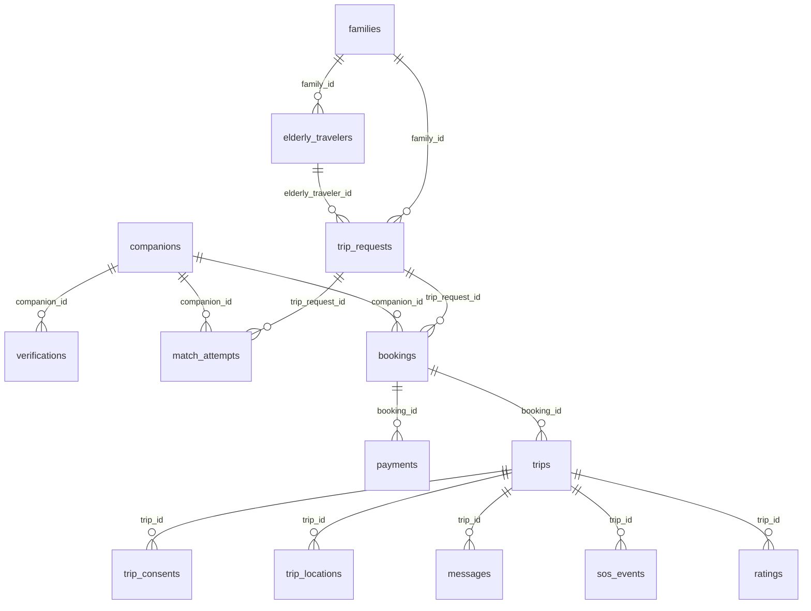

# TravelBuddy — database, RLS and consistency audit

5 October 2026. **SQL source model, not a live database dump.** Remote metadata/grants/history unavailable; local Supabase is not running. No SQL was executed, no migration edited/applied and no schema/data changed.

## Migrations, canonical vs archived

| File | Actual content / assessment |
|---|---|
| `supabase/migrations/20260905131626_clerk_schema.sql` (S) | 17 public tables; UUID internal PKs; Clerk TEXT references; uuid-ossp and pgcrypto extensions. CREATE TABLE IF NOT EXISTS is not a conversion of old existing tables |
| `supabase/migrations/20260905131803_clerk_rls.sql` (R) | current_clerk_id = auth.jwt()->>'sub'; ENABLE RLS on all 17 tables; 92 policies. No triggers, explicit grants, views or storage policies |
| `migrations_archive/20240101_init_schema.sql` | Attempts auth.users mirror with UUID and role; families.family_member_id, travelers.traveler_user_id, companions.user_id; plaintext sensitive fields; indexes and updated_at triggers |
| `migrations_archive/20240102_rls_policies.sql` | auth.uid() UUID ownership, full-row verified-companion public read, self-referencing auth.users admin policy |
| `migrations_archive/20240103_trip_requests.sql` | Requests table, six indexes, timestamp trigger and old Auth ownership policies; companion access explicitly postponed |
| `migrations_archive/20240104_elderly_travelers_update.sql` | Redundant family/user indexes, partial linked-traveler index, conditional own-read policy, updated_at trigger |

All six files were read. Archived files are not in the active migration directory and **must not be replayed to repair missing canonical indexes/triggers**. Mixing histories could leave old columns/policies because CREATE TABLE IF NOT EXISTS does not reconcile them; policy names can collide. No reviewed forward data conversion/backfill is present. `config.toml:58–70` mixes migration-directory schema_paths with missing seed file. Obtain actual migration history before any future schema change.

### Global schema facts

- Every table PK: `id UUID NOT NULL PRIMARY KEY DEFAULT gen_random_uuid()`. These create PK indexes. No active CREATE INDEX, partial index or updated_at trigger exists.
- FK deletions are CASCADE on all declared relationships; blanket cascade through financial, audit-adjacent and safety history needs retention/legal review.
- Clerk IDs are TEXT, **not FKs to auth.users or a local user table**. Clerk-account deletion/synchronization is not implemented.
- `created_at TIMESTAMPTZ NOT NULL DEFAULT now()` on all tables **except trip_consents**, which has `granted_at` instead. `updated_at` also has this default where shown, but will not advance automatically.
- No unique-one-booking/request, one-trip/booking, one-rating/rater/trip, match-run uniqueness or payment-event uniqueness exists. Scalar-subquery policies assume uniqueness that the schema does not enforce.
- No column-level grants/revokes; no declared storage bucket or object policies; no consent-controlled medical decrypt function. Comments about encrypted files/triggers are not implementations.

## ER model

`notifications`, `audit_logs` and `admin_roles` have no declared relational FKs. Identity references in ratings/messages/consents/SOS are free TEXT. Both request family_id and traveler family_id exist independently; nothing requires them to agree.

## Complete table/column ledger

Below, `?` means nullable (including defaults without NOT NULL). All inherit the UUID PK/created_at convention above. `U` = UNIQUE. `u_at` = updated_at TIMESTAMPTZ NOT NULL DEFAULT now(). Field encryption is **declared storage intent**, not verified cryptographic behavior.

### families — S:6–12

- Columns: family_member_clerk_id TEXT NOT NULL U; name TEXT NOT NULL; u_at.
- Owner: one Clerk family member. No multi-member family relationship table.
- Dependencies: none. Dependents: travelers/requests → bookings → trips. Unique owner index and PK only.
- Sensitive: name/identity. App readers: dashboard/list/edit/create ownership lookup. Writers: family create/edit.
- Lifecycle: single family created per identity, editable name; no ordinary delete policy. No trigger.

### elderly_travelers — S:15–27

- Columns: family_id UUID NOT NULL FK families; traveler_clerk_id TEXT? U; first_name/last_name TEXT NOT NULL; date_of_birth DATE?; medical_conditions/accessibility_needs/emergency_contacts BYTEA?; u_at.
- Owner: linked family and optional traveler identity. Dependent: requests. No family FK index beyond unrelated PK/identity unique indexes.
- Sensitive: names/DOB/medical/accessibility/emergency contacts; three BYTEA columns intended encrypted.
- App: traveler creation/detail/edit plus request detail/matching; currently expects encrypted arrays for two scalar BYTEA columns.
- Lifecycle: family-managed, optionally linked account; no account-link approval/invitation flow. No ordinary delete policy or triggers.

### companions — S:30–44

- Columns: user_clerk_id TEXT NOT NULL U; first_name/last_name TEXT NOT NULL; date_of_birth DATE?; languages_spoken TEXT[] NOT NULL DEFAULT '{}'; availability_calendar JSONB NOT NULL DEFAULT '{}'; verification_status TEXT NOT NULL DEFAULT pending CHECK pending/verified/expired/rejected; rating_average DECIMAL(3,2)? DEFAULT 0; total_trips INTEGER? DEFAULT 0; u_at.
- Dependencies: none. Dependents: verifications/matches/bookings. PK and unique identity indexes only.
- Sensitive: DOB, identity, availability. No capability/route/timezone records. Rating and trip totals have no bounds, authoritative aggregate or synchronization trigger.
- Writers/readers: companion screens; public browse/matching. RLS allows owner to modify trusted status/rating fields, despite read-only UI comments.

### verifications — S:47–58

- Columns: companion_id UUID NOT NULL FK companions; document_type/document_storage_path TEXT NOT NULL; background_check_status TEXT NOT NULL DEFAULT pending CHECK pending/passed/failed; verified_at/expires_at TIMESTAMPTZ?; u_at.
- Sensitive: document path/verification metadata; file “encrypted” only a comment. No bucket/path FK or document uniqueness/index.
- Owner: companion can read; admin decision intended. No implemented approval/expiry synchronization.
- App inserts/displays nonexistent `status`; ordinary companion cannot INSERT under source policies. No trigger or upload transaction.

### trip_requests — S:61–77

- Columns: family_id UUID NOT NULL FK families; elderly_traveler_id UUID NOT NULL FK travelers; origin_airport/destination_airport TEXT NOT NULL CHECK length=3; departure_date DATE NOT NULL; return_date DATE?; assistance_level TEXT NOT NULL CHECK minimal/moderate/maximum; language_requirements TEXT[]? DEFAULT '{}'; special_instructions TEXT?; status TEXT NOT NULL DEFAULT draft CHECK draft/searching/matched/booked/in_progress/completed/cancelled/expired; matching_criteria JSONB? DEFAULT '{}'; u_at.
- Owner: family; traveler self-read intended. Contains potentially sensitive plaintext special instructions.
- Dependents: match attempts/bookings. No FK/status/date/route indexes in active SQL.
- No same-family traveler constraint, valid IATA constraint, origin!=destination, date ordering or transition graph.
- Writers: create/edit pages and match status update. Source family UPDATE implicitly permits only resulting draft/searching states; normal matched transition is denied.

### match_attempts — S:80–88

- Columns: trip_request_id UUID NOT NULL FK requests; companion_id UUID NOT NULL FK companions; score DECIMAL(5,2) NOT NULL; explanation JSONB?; matched BOOLEAN NOT NULL DEFAULT false.
- Owner: request family; companion own rows readable. Score bounds/run version/attempt uniqueness absent.
- App instead expects match_score/status/match_attempted_at/updated_at and text explanations. No family UPDATE policy for selection.
- No canonical promotion/booking transition, selected uniqueness, expiry or transaction.

### bookings — S:91–104

- Columns: trip_request_id UUID NOT NULL FK requests; companion_id UUID NOT NULL FK companions; booking_reference TEXT NOT NULL U; total_amount DECIMAL(10,2) NOT NULL CHECK >=0; currency TEXT NOT NULL DEFAULT USD; payment_status TEXT NOT NULL DEFAULT pending CHECK pending/paid/failed/refunded/partially_refunded; status TEXT NOT NULL DEFAULT confirmed CHECK confirmed/cancelled_by_family/cancelled_by_companion/completed; u_at.
- Owner: request family and assigned companion. Dependents: payments/trips. Unique reference only; multiple bookings per request allowed.
- Sensitive: financial/relationship data. No dates, payment/verification prerequisite, acceptance record or pricing authority.
- No application reader/writer. RLS has no INSERT policy even for JWT admin; future service writer would need explicit ownership/state validation.

### payments — S:107–120

- Columns: booking_id UUID NOT NULL FK bookings; stripe_payment_intent_id/stripe_charge_id/stripe_refund_id TEXT?; amount_cents BIGINT NOT NULL; currency TEXT NOT NULL; type TEXT NOT NULL CHECK platform_fee/companion_payout/refund/charge; status TEXT NOT NULL CHECK succeeded/failed/pending.
- Owner: system ledger; JWT-admin access only in policy intent. No ordinary participant receipt read.
- No Stripe SDK, webhook, event ledger, idempotency or reconciliation implementation. Stripe references are nonunique/unindexed; amount may be negative; no reconciliation to booking amount/currency.
- No application access, triggers or stable payout relationship. Deleting booking cascades ledger rows.

### trips — S:123–133

- Columns: booking_id UUID NOT NULL FK bookings; start_time TIMESTAMPTZ NOT NULL; end_time TIMESTAMPTZ?; current_location BYTEA?; sos_triggered BOOLEAN NOT NULL DEFAULT false; last_check_in TIMESTAMPTZ?; u_at.
- Owner: booking participants. Dependents: consents, locations, messages, SOS, ratings.
- Sensitive: encrypted location intent. No one-trip/booking uniqueness, active/completed trip status, paid booking gate, chronological check, inserts or lifecycle implementation.
- Companion “location/check-in” UPDATE with CHECK TRUE is whole-row access, not a column restriction. No enforcement trigger exists.

### trip_consents — S:136–146

- Columns: trip_id UUID NOT NULL FK trips; data_type TEXT NOT NULL CHECK medical/accessibility/emergency; granted_by_clerk_id TEXT NOT NULL; granted_at TIMESTAMPTZ NOT NULL DEFAULT now(); expires_at/revoked_at TIMESTAMPTZ?; notes TEXT?.
- Owner intent: family/traveler grant; companion reads assigned-trip consents. No purpose/version or unique active consent.
- No application access or trigger. Grantor identity not checked; expiration/revocation are not consumed by any medical/accessibility policy.
- Family/traveler SELECT missing; nested traveler/companion graph traversal incorrect. No actual consent-gated sensitive sharing.

### trip_locations — S:149–156

- Columns: trip_id UUID NOT NULL FK trips; latitude/longitude DOUBLE PRECISION NOT NULL; accuracy INTEGER NOT NULL; recorded_at TIMESTAMPTZ NOT NULL DEFAULT now().
- Owner intent: assigned companion writes; family/companion reads. **Historical coordinates are plaintext**, unlike current_location.
- No valid coordinate range, accuracy>=0, freshness/order constraint, retention/cleanup job, FK/time index or realtime publication migration.
- No GPS API, polling/subscription or UI; battery/update frequency not implemented. No normal UPDATE/DELETE policies.

### messages — S:159–169

- Columns: trip_id UUID NOT NULL FK trips; sender_clerk_id TEXT NOT NULL; content TEXT NOT NULL; image_storage_path TEXT?; message_type TEXT NOT NULL DEFAULT text CHECK text/image/location; read_by TEXT[]? DEFAULT '{}'.
- Owner intent: trip participants read; sender edits/deletes. No INSERT policy, sender-membership constraint, message-size limit, editing window or author immutability trigger.
- Content is plaintext; encrypted file is comment-only. No recipients table, unread/read implementation, realtime, moderation or storage lifecycle.
- No application calls. Sender UPDATE applies to all columns subject to implicit sender check, not text only.

### notifications — S:173–183

- Columns: user_clerk_id TEXT NOT NULL; type TEXT NOT NULL CHECK trip_update/payment/sos/reminder/promotional/system; title TEXT NOT NULL; body/data BYTEA?; is_read BOOLEAN NOT NULL DEFAULT false; read_at TIMESTAMPTZ?.
- Owner: recipient identity. No recipient FK/index, event uniqueness, delivery status, retries or outbox.
- User UPDATE labelled read-only actually permits whole-row title/type/body/data mutations while ownership remains. No insert policy or application delivery/read code.

### sos_events — S:186–200

- Columns: trip_id UUID NOT NULL FK trips; triggered_by_clerk_id TEXT NOT NULL; triggered_at TIMESTAMPTZ NOT NULL DEFAULT now(); location BYTEA NOT NULL; status TEXT NOT NULL DEFAULT active CHECK active/acknowledged/resolved; acknowledged_by_clerk_id/resolved_by_clerk_id TEXT?; acknowledged_at/resolved_at TIMESTAMPTZ?; resolution_note TEXT?.
- Owner intent: participants; actor-bound updates; admin override. No INSERT, enforced transition/timestamp relationship, deduplication, response deadline or immutable incident history.
- No implementation of trigger, notification, acknowledgement, escalation, rescue response or resolution. Boolean trips.sos_triggered and event state can diverge.
- Resolution note plaintext may contain PII. Relationship policies contain incorrect traversal.

### ratings — S:203–212

- Columns: trip_id UUID NOT NULL FK trips; rater_clerk_id/ratee_clerk_id TEXT NOT NULL; score INTEGER NOT NULL CHECK 1..5; comment TEXT?; u_at.
- Owner intent: rater edit/delete; admin read/edit/delete. No INSERT or completed-trip/participant check; no one-rating uniqueness/self-rating ban/window.
- No aggregate updater for companion rating_average/total_trips; no application workflow. Comments plaintext; deleting trip cascades ratings.

### audit_logs — S:215–230

- Columns: user_clerk_id TEXT?; action TEXT NOT NULL CHECK CREATE/UPDATE/DELETE/LOGIN/LOGOUT/SOS_TRIGGER/SOS_ACKNOWLEDGE/SOS_RESOLVE/PAYMENT/REFUND/ADMIN_OVERRIDE/VERIFICATION; table_name TEXT NOT NULL; record_id UUID NOT NULL; changes BYTEA?; ip_address INET?; user_agent TEXT?.
- Owner: system audit. JWT-admin SELECT only; no ordinary insert/update/delete. `record_id` has no FK; no immutable writer/trigger, redaction/encryption implementation or retention definition.
- No application code writes audits. Comments about system/triggers do not establish an audit trail. IP/user agent/changes potentially sensitive.

### admin_roles — S:233–238

- Columns: clerk_id TEXT NOT NULL U; role TEXT NOT NULL CHECK super_admin/moderator/support.
- Owner intent: own read and super-admin administration. SELECT and ALL policies query admin_roles itself; recursive RLS risk.
- No provisioning flow/first-admin bootstrap/permissions resolver. Other tables ignore this table and instead read top-level JWT role=admin; two unrelated admin systems.

## RLS interpretation — important precision

All source policies are permissive and omit `TO`, so default to PUBLIC (subject to actual SQL grants). The helper reads JWT sub; it does **not** validate a Clerk token by itself. Verified third-party issuer integration is mandatory. `auth.uid()` appears only in archived SQL, while legacy `supabase.auth` remains active in application code.

PostgreSQL 17 uses USING for the new-row check when UPDATE/ALL omits WITH CHECK. Consequently **absence of explicit WITH CHECK alone does not imply ownership transfer is unrestricted**. Matching's draft→matched is denied by this implicit check. Conversely, explicit CHECK TRUE or pending-only checks can fail to bind the new relationship. All findings below assume applicable table/column grants; live grants were not read. Service-role bypass is a privileged-server boundary, not a remedy for denied user operations.

## Every table's policy coverage

S/I/U/D = SELECT/INSERT/UPDATE/DELETE; A = top-level JWT role=admin; F = family owner; T = traveler identity; C = companion owner. “None” means no policy for normal SQL roles, not no service-role access. RLS enabled in **source** for every row below. Policy ranges collectively cover all 92 definitions in R; never interpret policy labels as column restrictions.

| Table / R lines | SELECT | INSERT | UPDATE | DELETE | Audit result |
|---|---|---|---|---|---|
| families 8–28 | Owner or A | Owner ID or A | Owner or A (implicit new-row owner check) | None | Owner scope generally sound; no app role requirement; one family per identity |
| elderly_travelers 30–74 | F, linked T, A | F or A | F, T, A | None | No verified traveler-link flow; family can choose linked identity; T update not column restricted; cross-family relationship invariant missing |
| companions 76–99 | C, **any role for verified rows**, A | C or A | C or A | None | CRITICAL self-verification/rating tampering; HIGH public whole-row DOB/identity/calendar disclosure |
| verifications 101–130 | C through companion, A | **A only** | C existing ownership + new background pending, or A | None | HIGH new ownership not bound by explicit CHECK; forged timestamps/path allowed; normal upload insert denied |
| trip_requests 132–190 | F, T, A | F only | F existing/result draft/searching or A | F draft/searching or A | HIGH cross-family traveler reference allowed; matched progression denied; direct INSERT can select any enumerated status |
| match_attempts 192–234 | F through request or C, A | F through request or A | A only | A only | Family acceptance denied; F can forge score/matched/candidate relationship; no eligible-companion prerequisite |
| bookings 235–286 | F through request or C, A | **None** | F pending or C paid, or A; implicit result check | A only | HIGH cancellation labels allow broad amount/currency/reference/status changes; family cannot change pending→paid under own implicit predicate |
| payments 288–299 | A | A | A | None | System-only intent, but system writer absent; no user receipts, event uniqueness or webhook authorization boundary |
| trips 301–362 | F or C through booking, A | **None** | C + CHECK TRUE; F/C SOS + CHECK sos_triggered true; A | None | HIGH field/relationship mutation, no column triggers, SOS policy ORs with broad C access; no paid/active/consent restrictions |
| trip_consents 364–446 | C assigned graph (wrong), A; **no F/T** | F/T via nested graph | F/T graph or A | F/T graph or A | HIGH wrong traversal, no reader support for grantor revocation, forged grantor, expiration unused; scalar assumptions unsafe |
| trip_locations 448–486 | F graph or C, A | Assigned C | None | None | HIGH plaintext precise history/retention; no active/paid check; F scalar booking lookup may return >1 row |
| messages 488–520 | F graph or C graph (wrong), A | **None** | Sender ID (no time gate) | Sender ID | HIGH missing membership/immutability for resulting trip field; no send policy; reader graph can fail |
| notifications 522–533 | Recipient or A | **None** | Recipient (whole row) | None | MEDIUM user can modify content/type, not only read state; title plaintext; no delivery writer |
| sos_events 535–579 | F or C graph (wrong), A | **None** | Triggering/acknowledging/resolving actor by status or A | None | HIGH inaccurate participant traversal and no incident creation; “resolved” branch permits edits to resolved rows; transitions/timestamps not enforced |
| ratings 581–603 | Rater or A | **None** | Rater or A | Rater or A | MEDIUM no completed-trip/ratee invariant; edits unbounded in time; future write path absent; aggregates disconnected |
| audit_logs 605–610 | A | None | None | None | HIGH operational audit absent; normal clients denied as intended but no trusted system writer/trigger |
| admin_roles 612–634 | Own ID or recursive super-admin | Recursive super-admin ALL | Recursive super-admin ALL | Recursive super-admin ALL | HIGH self-referential RLS; bootstrap missing; roles unused by all other policies |

### Relationship-policy defects (STATIC, not a claimed migration parse failure)

- R:382,402,422 use `(SELECT trip_id FROM public.trips ...)` where the trip relationship needed is `booking_id`. `trips` has no trip_id. **Unqualified SQL names may resolve to an outer policy row**, so this can be a silently correlated wrong UUID instead of a missing-column parser error. Traveller consent resolution compares booking IDs with trip IDs and does not follow the ER graph.
- R:433,505,551 similarly query `trip_request_id` from trip_requests and `trip_id` from trips where those columns are not defined locally. Outer aliases/rows can supply values; request/trip/booking IDs are traversed incorrectly. Do not “fix” by adding bogus columns to match these queries; follow trip.booking_id→booking.trip_request_id.
- R:372,392,412,467,497,543 assume a scalar booking per request; schema permits many. Multiple bookings can produce cardinality errors in policy evaluation.
- R:621–634 selects admin_roles within its own policies; no SECURITY DEFINER helper or non-recursive trust source exists.
- F/T consent UPDATE/DELETE lack F/T SELECT; filtered updates typically require read access. Companion/traveler relationship subqueries are subject to underlying RLS; no general assigned-companion read of trip_requests exists.
- No regular companion can read another family's medical/accessibility records under current traveler SELECT policies; the intended consent-sharing implementation is **missing**, not evidence of a working consent boundary.

### Security classifications

**CRITICAL:** companions self-promote to verified under own INSERT/UPDATE if ordinary full-column grants apply (R:81–86). **HIGH:** verified-companion full-row exposure; trip/verification field update boundaries; cross-family traveler/request relation; consent/trip traversal; recursive admin RLS; no operational immutable audit/safety writers. **MEDIUM:** notification full-row mutation, missing bounded rating windows/uniqueness. **LOW/INFORMATIONAL:** missing explicit TO scope, helper search_path hardening opportunity (helper is not SECURITY DEFINER), timestamp drift and absent FK indexes. Severity does not assert live exploitation without deployed grant/policy checks.

## Database → application consistency register

| Actual SQL | Application expectation / location | Severity | Primary fix and owner |
|---|---|---|---|
| families.family_member_clerk_id TEXT | family_member_id in edit/travelers/requests/actions | HIGH | Change application identity/query contract to canonical Clerk field; do not restore legacy UUID column |
| Clerk external user, no Supabase login bridge | supabase.auth.getUser throughout CRUD and all matching actions | HIGH | Request-scoped Clerk auth/token client; application fix and integration configuration |
| companions.user_clerk_id TEXT | companion create populates it from a Supabase UUID | HIGH | Derive authenticated Clerk ID; application |
| traveler medical/accessibility BYTEA scalar | encryption helper returns string[]; decrypt assumes array.map | HIGH | Encrypt serialized arrays once as server-side BYTEA; application serialization and controlled crypto API |
| pgcrypto functions in extension schema/actual positional names | rpc pgp_sym_encrypt({plaintext,key}) / decrypt({ciphertext,key}) | HIGH | Explicit narrow server crypto contract; no matching wrapper declared in active migrations; review extensions schema/live function exposure |
| verifications.background_check_status | inserts/displays verification.status in both companion paths | HIGH | Align application with background_check_status; owner upload operation must not grant approval authority |
| match_attempts.score/matched/created_at, explanation JSONB | match_score/status/match_attempted_at/updated_at and text explanation | HIGH | Agree lifecycle first; adapt current prototype to schema or approve forward schema extension for real match decisions; no silent migration edits |
| requests traveler FK is many-to-one | requests list indexes elderly_travelers[0] | HIGH | Generated DB relationship types + object access; application |
| trip_requests.family_id independent of traveler family | insert accepts browser-provided elderly_traveler_id | HIGH | Validate ownership server-side and enforce composite relationship invariant via future forward migration |
| 17 canonical tables, no generated Database type | ad hoc interfaces, any Supabase generic responses | MEDIUM | Generate types from approved verified schema; use typed client + DTO boundary |
| updated_at only default | matching updates nonexistent timestamp; others assume automatic updates | MEDIUM | Forward timestamp trigger on actual timestamped tables + remove nonexistent updates |
| normal match UPDATE absent; requests new status limited | accept action then client changes request to matched | HIGH | One authorized transactional selection operation with guarded state transitions |
| nested policy graph wrong/unconstrained scalar cardinality | consent/chat/SOS intent assumes correct assigned-trip access | HIGH | Repair qualified graph predicates in new migration after drift verification; add negative/multi-booking RLS tests |
| no bucket/object policies | upload uses companion-verifications bucket | HIGH | Explicit private bucket/policies/controlled signed access as reviewed forward config, not public URLs |

## Required live verification before implementation

Read-only metadata needed: migration history, information_schema columns/constraints, pg_indexes, pg_policies and relrowsecurity, grants/default privileges, function signatures/search paths, extensions schemas, storage bucket config/object policies and Clerk issuer integration. Compare canonical files with actual deployment before choosing forward migrations. Never infer applied RLS from ENABLE statements on disk or claim missing policies are deployed findings without that comparison.
